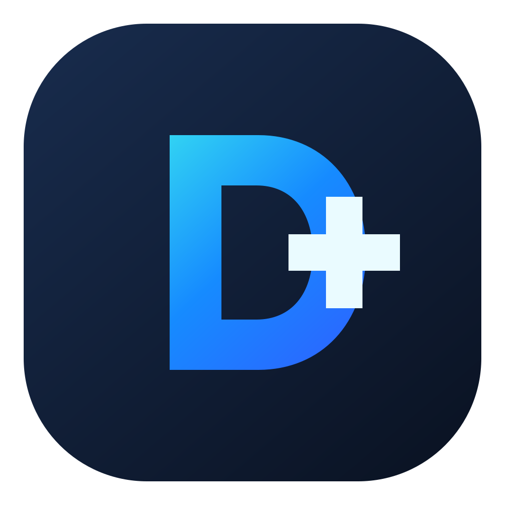

<div align="center">
  

  <h1>Dev+ Control</h1>

  <p>Cliente desktop personalizado para gerenciar instâncias, bots e scripts Minecraft.</p>

  <a href="LICENSE"></a>
  <a href="https://github.com/GuizeraaaXyz/devplus-control/releases"></a>
</div>

## Sobre

O Dev+ Control é uma distribuição personalizada do SoulFireClient, com interface e marca próprias por Dogcode_. Ele funciona como cliente para um servidor SoulFire e utiliza a API oficial gRPC do projeto original.

O aplicativo pode ser usado como cliente web ou desktop. No desktop, é possível iniciar um servidor integrado local ou conectar-se a um servidor remoto compatível. A interface oferece gerenciamento de instâncias e bots, além de um editor visual de scripts.

Alguns recursos comerciais do Dev+ Control exigem uma licença Dev+ ativa. A ativação e a consulta do status da licença dependem de conexão com o serviço online.

> Para conhecer o projeto original e o servidor, consulte o [repositório SoulFire](https://github.com/soulfiremc-com/SoulFire).

## Download e instalação

Os instaladores publicados ficam na página de [releases do GitHub](https://github.com/GuizeraaaXyz/devplus-control/releases). Para Windows x64, o asset do instalador é `DevPlus-Control-Setup.exe` quando incluído na release.

1. Baixe o instalador da release desejada.
2. Execute `DevPlus-Control-Setup.exe` e siga as instruções do instalador.
3. Abra o Dev+ Control e escolha um servidor integrado ou remoto compatível.
4. Se necessário, ative sua licença Dev+ pela tela de licença do aplicativo.

## Desenvolvimento

Instale a versão do Bun indicada em `package.json` e a versão LTS do Node.js usada pelo CI antes de iniciar.

```bash
bun install
bun run dev                 # Cliente Electron com Vite
bun run dev:web             # Cliente web com Vite
bun run typecheck           # Verificação TypeScript
bun run lint                # Verificação Oxlint
bun run build:web           # Build web
bun run build:windows       # Instalador Windows x64
```

O instalador Windows é criado em `release-artifacts/DevPlus-Control-Setup.exe`. A geração da marca atualiza os ícones e o favicon a partir de `branding/devplus-logo.png`:

```bash
bun run branding:generate
bun run branding:check
```

Consulte [`DEVPLUS.md`](DEVPLUS.md) para detalhes das personalizações, da distribuição do código-fonte e dos recursos de marca.

## Atualizar os bindings RPC

Os bindings RPC são gerados a partir dos esquemas do repositório SoulFire usando [Buf](https://buf.build/docs/generate/). O arquivo `buf.gen.yaml` fixa a origem em um hash completo de commit; a revisão do servidor também fixa os esquemas importados em `buf.lock`.

1. Envie as alterações de protocolo para o repositório SoulFire.
2. Atualize `inputs[0].ref` em `buf.gen.yaml` com o hash completo do commit.
3. Execute `bun run protocol:generate`.
4. Atualize o código afetado e execute `bun run typecheck`, `bun test` e `bun run build:web`.
5. Envie juntos o pin, os bindings gerados e as alterações do cliente.

Os arquivos gerados em `src/generated/` são versionados. Builds normais não baixam esquemas nem precisam de um checkout do servidor. O CI regenera os bindings e verifica diferenças. A geração exige Git e acesso de rede ao GitHub e ao Buf Schema Registry; as versões das ferramentas estão fixadas em `package.json` e `bun.lock`.

Para desenvolvimento local do protocolo, execute `bun run protocol:generate -- ../SoulFire` usando um checkout local do servidor. Antes de enviar as alterações do cliente, restaure o pin remoto e regenere sem o caminho local.

Novas funcionalidades precisam continuar lidando com servidores antigos que não incluam campos opcionais ou não implementem métodos RPC recentes.

## Contribuição e suporte

- Leia [`CONTRIBUTING.md`](CONTRIBUTING.md) para conhecer o fluxo de desenvolvimento e revisão.
- Abra uma [issue neste repositório](https://github.com/GuizeraaaXyz/devplus-control/issues) para relatar problemas do Dev+ Control.
- Consulte o [código de conduta da comunidade SoulFire](https://github.com/soulfiremc-com/.github/blob/main/CODE_OF_CONDUCT.md) ao participar do projeto upstream.
- Para relatar uma vulnerabilidade no projeto original, use os [contatos privados de segurança do SoulFire](https://github.com/soulfiremc-com/.github/blob/main/SECURITY.md).

## Licença e atribuição

O Dev+ Control é uma distribuição personalizada baseada no SoulFireClient e em seus contribuidores. O projeto original é licenciado sob a [AGPL-3.0](LICENSE); seus avisos e atribuições permanecem no código-fonte. Consulte [`DEVPLUS.md`](DEVPLUS.md) para as condições de distribuição do código-fonte correspondente a uma versão modificada.
